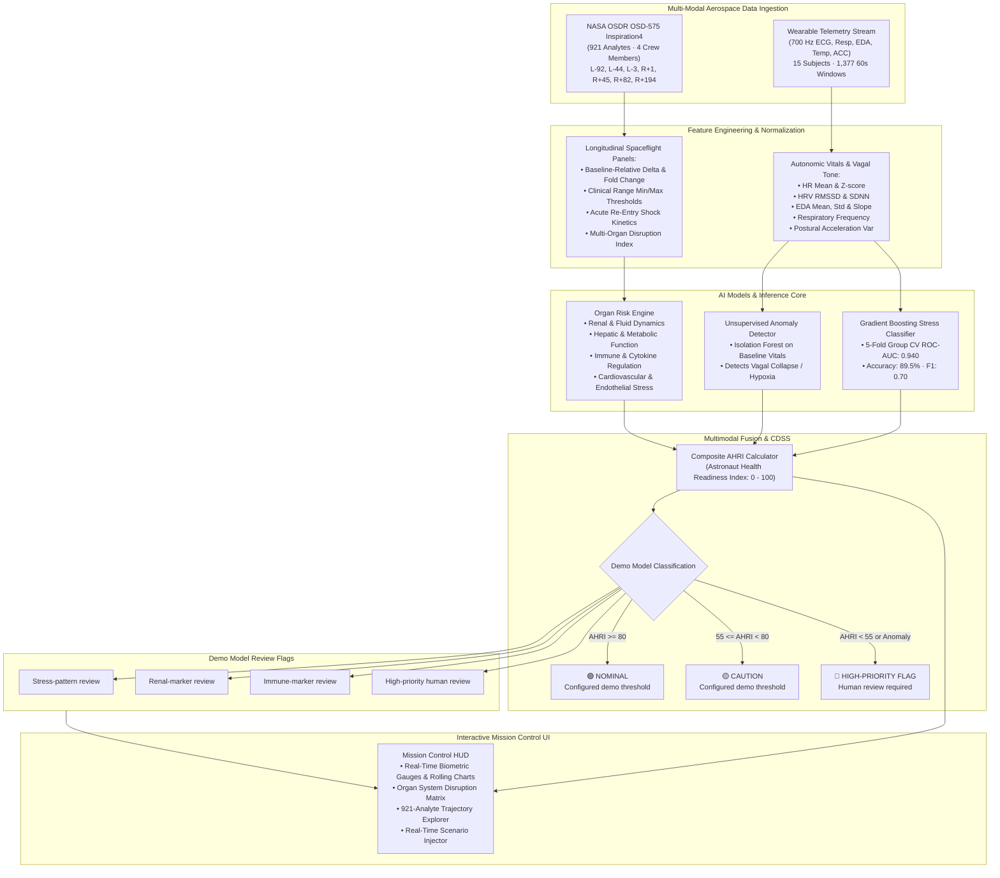

# 🚀 NASA Astronaut Health Monitoring & Clinical Decision Support System (CDSS)

An educational research prototype exploring astronaut-health dashboards and mission-environment scenarios. It is not a medical device, has not been validated for clinical or flight use, and must not be used to diagnose or direct treatment.

The dashboard replays WESAD research data and historical OSD-575 measurements from four Inspiration4 crew members; it is not connected to astronaut wearables, live laboratory systems, or spacecraft sensors. The optional camera rPPG feature is experimental: it sends regional RGB averages to the local server, not video, and does not provide a clinical assessment. Real missions require validated sensors, qualified medical oversight, and independent verification of every model.

---

## 🛰️ System Architecture



---

## 📊 Key Machine Learning & Clinical Metrics

### 1. Research-Dataset Stress Classification (WESAD)
- **Model**: Gradient Boosting Classifier + Random Forest + Isolation Forest.
- **Cross-Validation**: 5-Fold `GroupKFold` strictly grouped across 15 WESAD subjects (unseen subject evaluation).
- **Binary Stress Detection**:
  - **Reported Group-CV ROC-AUC**: `0.940 ± 0.051`
  - **Reported Group-CV Accuracy**: `89.5% ± 5.8%`
  - **Reported Group-CV F1 Score**: `0.696 ± 0.205`
  - These dataset results do not establish astronaut or clinical performance.
- **Top 5 Predictive Biometric Features**:
  1. `hr_mean_z` (Heart rate baseline z-score shift): **39.06%**
  2. `acc_std` (Postural motion / tremor variance): **25.16%**
  3. `eda_slope` (Sympathetic sweat gland rate of change): **11.06%**
  4. `eda_std_z` (Galvanic skin conductance volatility): **5.00%**
  5. `temp_mean_z` (Skin thermal dissipation shift): **4.84%**

### 2. Multi-Organ Spaceflight Disruption (NASA OSD-575 Inspiration4)
- **4 Astronauts**: `C001`, `C002`, `C003`, `C004`.
- **7 Mission Timepoints**: `L-92`, `L-44`, `L-3` (Pre-flight Baseline), `R+1` (Acute Re-entry), `R+45`, `R+82`, `R+194` (Recovery Kinetics).
- **921 Total Analytes**:
  - **Renal & Fluid Dynamics**: BUN, Creatinine, eGFR, Sodium, Potassium, Chloride, Calcium.
  - **Hepatic & Metabolic**: ALT, AST, Alkaline Phosphatase, Bilirubin, Albumin, Glucose.
  - **Immune & Cytokines**: CRP (1.46x re-entry change), IL-6, TNFα, IFNγ, IL-10 (1.53x change), MCP-1.
  - **Cardiovascular & Endothelial**: Fibrinogen, Serum Amyloid P (SAP), Haptoglobin (1.50x change), PF4, L-Selectin.

---

## ⚡ Quick Start & Execution

### 1. Activate Environment
```powershell
.\.venv\Scripts\Activate.ps1
```

### 2. Run the Validation Test Suite
```powershell
python tests/test_system.py
```
*Output: 100% pass rate across Organ Risk Engine, Longitudinal Timelines, Telemetry Simulator, and Multimodal Fusion.*

### 3. Launch Mission Control Dashboard & REST API
```powershell
python src/server.py 8080
```
Open **[http://127.0.0.1:8080](http://127.0.0.1:8080)** in your browser.

---

## 🎮 Interactive Dashboard Features

1. **WESAD Telemetry Replay HUD**:
   - Displays sample heart rate, HRV, respiration, EDA, temperature, and motion features; these are replay/demo values, not live crew measurements.
   - Rolling chart and scenario injection for demonstration only.
2. **Scenario Injector**:
   - `🟢 Nominal Orbit`: Resting microgravity homeostasis.
   - `🔵 Spacewalk (EVA)`: High physical exertion with elevated heart rate and accelerometer variance.
   - `🟡 Cognitive Stress`: Acute tachycardia, vagal RMSSD collapse, and surging galvanic skin conductance.
   - `🔴 Anomaly / Hypoxia`: Synthetic anomaly scenario; not a real emergency detector.
3. **Organ System Health Matrix**:
   - Historical biomarker summaries for Renal, Hepatic, Immune, and Cardiovascular panels.
   - Shows observed dataset values; not real-time labs or individual medical advice.
4. **Longitudinal Biomarker Explorer**:
   - Select any analyte (e.g. `CRP`, `CREATININE`, `IL-6`, `ALT`, `CALCIUM`) to visualize trajectories from L-92 through R+194 against baseline means.
5. **Prototype Model-Output Demonstration**:
   - Shows threshold-based research flags for discussion; it does not prescribe treatment or direct mission operations.
   - Includes one-click JSON export of demo/model output.
6. **Experimental Camera Pulse Demo**:
   - Camera access begins only after the user starts it. Local browser sampling sends RGB summaries to the local API; the camera video itself is not uploaded or saved.
   - The camera tab hides the historical crew/timepoint selectors. Camera estimates are saved to a separate local demo table without astronaut identity; they are not clinical records.
   - Estimates may be inaccurate and are not for clinical use. A simulated feed is explicitly labeled.
7. **Mars Mission-Environment Scenarios**:
   - A 3D planetary/radiation view and a human-impact avatar visualize illustrative model indices for fluid shift, SANS, bone loss, radiation planning, and atmospheric oxygen.
   - These are not crew health measurements, validated danger thresholds, individual survival predictions, or mission dosimetry.

The crew-facing ACO optimization panel was removed because it is model-development material rather than an astronaut monitoring function. Its research code and artifacts remain available under `src/models/` and `models/saved/`.

---

## 📁 Repository Structure

```
├── README.md                     # Project overview and quick start
├── preprocess.py                 # Multi-panel ETL & dataset cleaner (OSD-575 + WESAD)
├── make_synthetic.py             # Synthetic offline test data generator
├── requirements.txt              # Project dependencies
├── docs/                         # Setup, architecture, design, security, and QA guides
├── data/                         # Persistent SQLite health database
├── models/
│   └── saved/                    # Trained ML artifacts and ACO results
├── processed/                    # Cleaned longitudinal & feature tables (CSV & QC JSON)
├── test/                         # Synthetic dataset fixtures
├── tests/
│   └── test_system.py            # Comprehensive validation test suite
├── src/
│   ├── models/
│   │   ├── train_models.py       # ML training pipeline with GroupKFold CV
│   │   ├── organ_risk_engine.py  # Clinical biomarker spaceflight risk engine
│   │   └── fusion_engine.py      # Multimodal AHRI calculation & triage logic
│   ├── simulator.py              # Telemetry window streamer & scenario generator
│   ├── server.py                 # Standalone HTTP REST API & dashboard server
│   └── static/
│       └── index.html            # Mission Control interactive web dashboard
└── START_SERVER.bat              # Windows dashboard launcher
```

Raw OSD-575 and WESAD files and generated health-data outputs are local-only and excluded from Git. The repository includes saved model artifacts, but rebuilding the processed data or retraining models requires obtaining the source datasets separately and following [docs/SETUP.md](./docs/SETUP.md).
